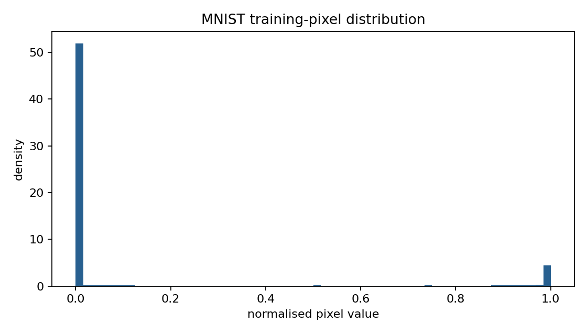
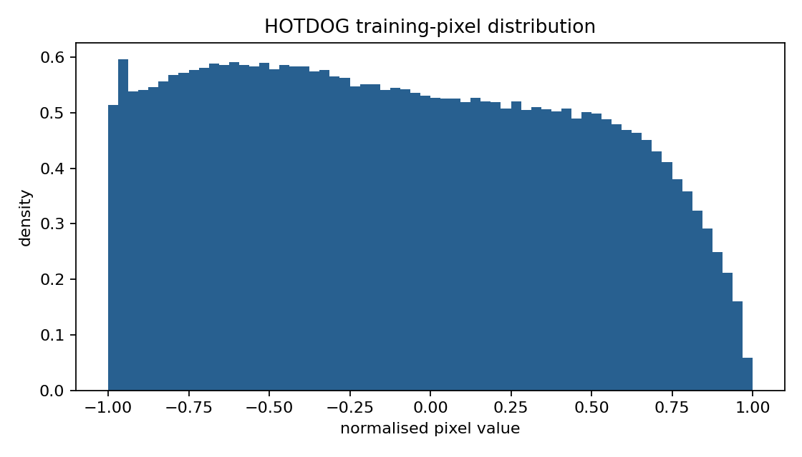
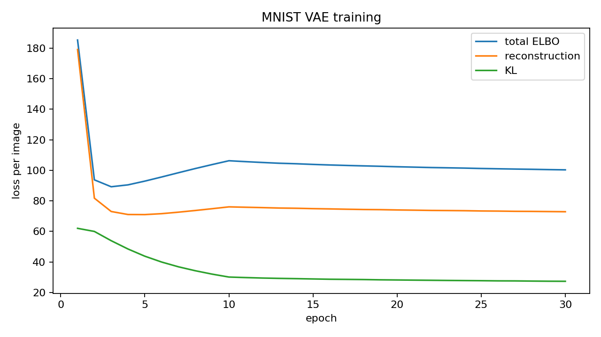
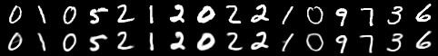
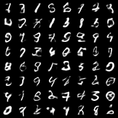
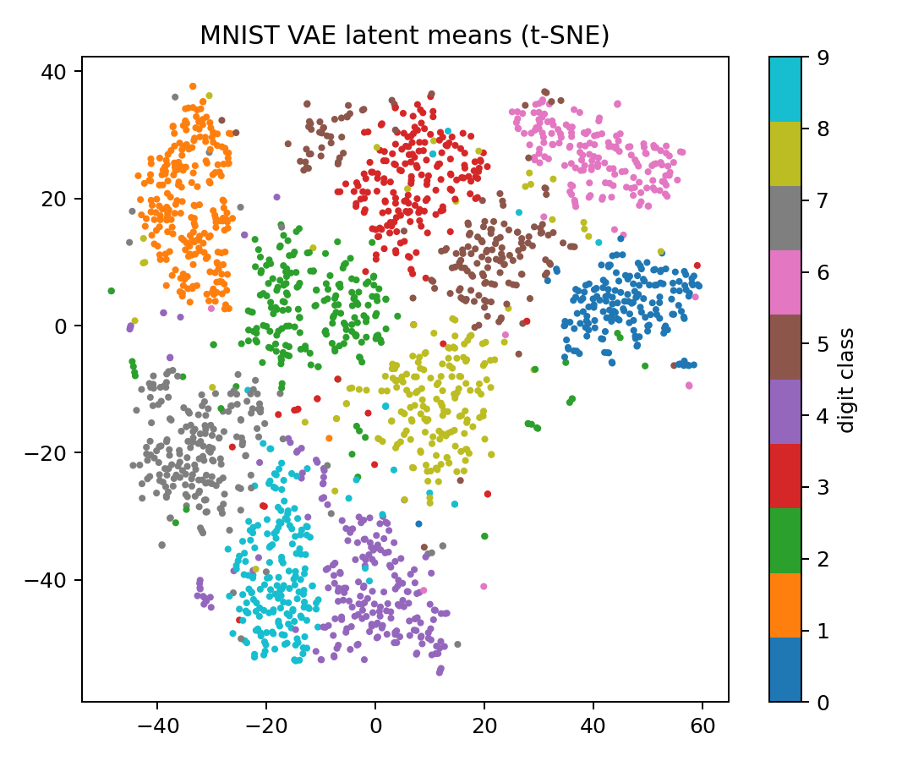
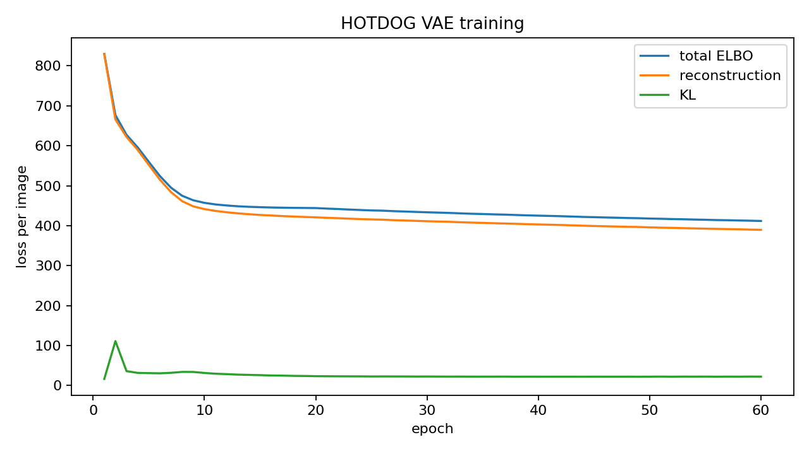
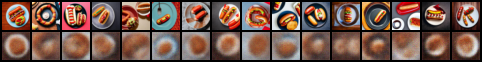
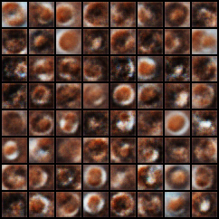
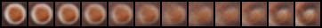

# Part 1 VAE model card

## Architecture and parameter count

I used one deliberately small convolutional VAE topology for both stages.  The
encoder maps 28x28 images through 32, 64, and 128 channels (28 -> 14 -> 7),
then has separate linear heads for the posterior mean and log-variance.  A
linear projection followed by two transposed-convolution blocks and a final
convolution forms the decoder.  Sampling uses the reparameterisation trick,
`z = mu + exp(0.5 * logvar) * eps`, where `eps ~ N(0, I)`.

| Stage | Channels / latent size | Output | Parameters |
| --- | --- | --- | ---: |
| MNIST | 1 / 32 | sigmoid | 880,481 |
| Hot dogs | 3 / 10 | tanh | 468,087 |

Both variants are below the one-million-parameter limit.  The hot-dog version
has fewer parameters because it has the smaller 10-dimensional latent.

## Likelihood choice and training

MNIST values are in [0, 1] and are close to binary foreground/background
pixels, so I used a Bernoulli likelihood: sigmoid decoder output and binary
cross-entropy reconstruction term.  Hot-dog pixels are continuous RGB values;
I resized to 28x28, normalized them to [-1, 1], used a tanh decoder, and used
squared error, corresponding to a fixed-variance Gaussian likelihood.  The
pixel histograms below show the difference in their observed distributions.

Both stages used Adam (learning rate 2e-4), seed 60038, and beta-VAE KL
annealing from 0 to 1 over the first third of training.  I trained MNIST for
30 epochs with batch size 256 (2.3 minutes).  I trained hot dogs for 60 epochs
with batch size 1024; after a one-time cache of the 28x28 tensors in GPU memory,
its measured optimization loop took 16.8 seconds.  Both runs used an NVIDIA
GeForce RTX 4070 SUPER.

## MNIST evaluation

The loss terms remain distinct during training, the reconstructions preserve
the input digit identity, and independent prior samples are usually recognisable
digits.  The t-SNE uses posterior means of 2,000 held-out images, coloured by
their digit labels.  It shows useful class structure, although related digit
forms overlap.

## Hot-dog evaluation

Reconstructions retain broad composition, colour, and some plate/background
structure, but are soft.  In contrast, samples drawn from the standard-normal
prior are varied brown/beige blobs rather than crisp hot dogs.  The local
public-classifier score on 64 generated images was 0.0054, with zero detected
near-duplicate fraction.  This is effectively the coursework's expected noise
floor for the Part 1 VAE.

## Analysis

MNIST works because its image distribution has a small number of strongly
separated, nearly binary modes.  A compact continuous latent and simple pixel
likelihood can preserve enough of that structure that prior samples land near
digit-like regions.  The latent interpolation is correspondingly smooth.

Hot-dog images have much more variation in viewpoint, framing, lighting,
toppings, plates, and backgrounds.  Squared-error reconstruction is the
appropriate Gaussian likelihood here, but it rewards the conditional average
of plausible pixels.  The small decoder can reconstruct when `z` contains an
image-specific code, but a random prior point falls between many visual modes;
the decoded average becomes a smooth, brown/beige blob.  This is a limitation
of the constrained VAE/objective rather than evidence of an implementation
error.  The strong reconstructions alongside poor prior samples demonstrate
that distinction.

## Leaderboard entry

No leaderboard submission has been made.  After you submit a chosen commit and
the row is scored, save a readable screenshot showing that commit hash and score
as `figures/leaderboard.png`, then add it here.

## Assistance and external code

The supplied course utilities provided the hot-dog dataset and public
classifier.  OpenAI Codex assistance was used to implement the training and
sampling code, set up the local environment, run experiments, and draft this
model card.  No pretrained component, diffusion model, or flow-matching model
was used in this Part 1 VAE.
